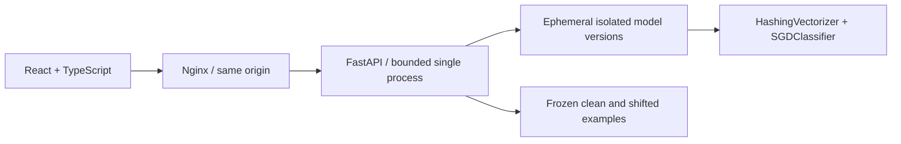

# OutcomeLab — Break It. Teach It. Measure It.

An English-first, non-commercial AI reliability playground. Route a synthetic support ticket, correct a linear classifier, then inspect measured changes on frozen clean and shifted data. No fabricated learning or promised gains.

Live demo: [outcomelab.zhongjiehuang.com](https://outcomelab.zhongjiehuang.com). Deployed behind Nginx with a dedicated, resource-limited systemd service; see [live deployment record](docs/LIVE_DEPLOYMENT.md).

Source: [zhjpersonal83-cell/outcomelab](https://github.com/zhjpersonal83-cell/outcomelab).

## Run locally
Requires Python 3.12, Node 22, pnpm 11.25.0. `make setup`, then in two terminals:

```sh
cd backend && ../.venv/bin/uvicorn app:app --host 127.0.0.1 --port 8000 --no-access-log
```
```sh
cd frontend && pnpm dev
```
Open http://localhost:5173. `make test lint build` validates the source. Browser test: `cd frontend && pnpm exec playwright install chromium && pnpm test:e2e` (activate the Python venv first). Docker alternative: copy `.env.example` to `.env`, then `docker compose up --build -d`; open http://localhost:8080.

## Architecture

The model has 4096 hashed features and three labels: account, billing, delivery. Seed 41 fixes training. The server deep-copies the baseline per sandbox; a global lock serializes mutations and evaluation. Twenty updates, 128 sessions and 30-minute inactivity expiry bound memory. Version snapshots enable exact rollback. Sessions are bearer capabilities held only in browser memory. Reload starts fresh. PostgreSQL is deliberately omitted: no accounts, durable feedback or shared training need storage. No migrations are needed.

## One-minute demo
0–15s: run the mixed invoice/parcel example. Inspect three probabilities. 15–30s: assign the intended queue and apply a correction; this performs one real gradient update. 30–45s: compare baseline/current scores and inject distractor words. 45–60s: inspect the confusion matrix and calibration bins, roll back, then export the experiment. Scores can improve, remain unchanged or get worse.

See [methodology](docs/METHODOLOGY.md), [threat model](docs/THREAT_MODEL.md), [deployment](docs/DEPLOYMENT.md), and [verification](docs/VERIFICATION.md). OpenAPI is generated at `/openapi.json` on the backend (proxied in Docker); interactive documentation is at backend `/docs` during local development.

## Ownership and scope
New, independent implementation for OutcomeLab, created with AI assistance from the supplied product brief. No IAFM or Marginloom source was used. No credentials, accounts, third-party analytics or commercial features. No claims about degrees, awards, employment or visa eligibility. This personal portfolio demo is not a statement of legal eligibility.

## Recruiter deep dive
Inspect `backend/app.py` for reproducible partitions, real incremental updates, capacity controls and exact rollback; `backend/tests/test_app.py` for isolation/concurrency and leakage checks; frontend for accessible interactive state; and CI/Compose for delivery design. Tradeoff: one locked process provides clear session consistency but limited throughput. Horizontal scaling requires sticky routing or a redesigned session store. This is a polished MVP, not a certified production service.
